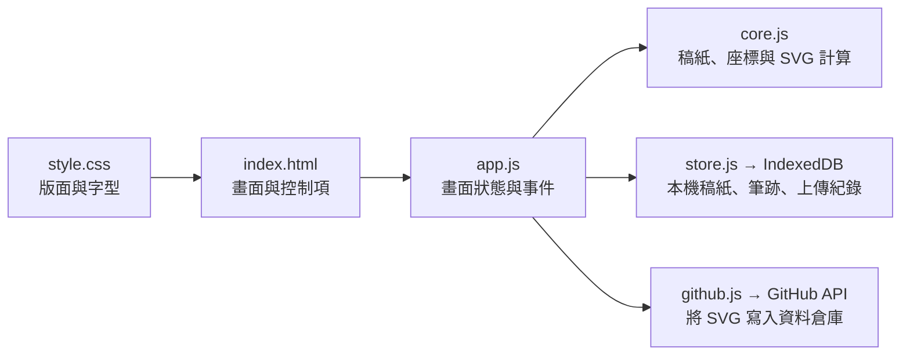

# InkTrace Web 專案導覽

InkTrace Web 讓使用者針對同一個題字，在左欄寫工整版、在右欄寫潦草版。每欄有自己的筆跡和上傳紀錄。GitHub Pages 提供網頁檔案，瀏覽器負責書寫、草稿保存與 SVG 匯出，使用者按下「上傳 GitHub」時才會將筆跡送往指定的資料倉庫。

## 1. 從哪裡讀起

先打開 [index.html](index.html) 找到畫面元件，再到 [app.js](app.js) 找該元件的事件。事件需要驗證資料、計算或匯出時，會使用 [core.js](core.js)。保存草稿與上傳則分別交給 [store.js](store.js) 和 [github.js](github.js)。

## 2. 檔案分工

| 檔案 | 負責的工作 |
| --- | --- |
| [`index.html`](index.html) | 頁面結構。包含首頁稿紙列表、搜尋、新增／改名表單、雙畫布、筆刷控制、進度、GitHub 設定和 JSON 匯入對話框。兩欄以 `data-board="regular"`(工整)、`data-board="rough"`(潦草) 區分。 |
| [`style.css`](style.css) | 配色、卡片、按鈕、淺深色主題、桌面與手機版面。`@font-face` 指向內附字型，`.board-grid` 負責左右排列，`.paper` 負責方形字格與輔助十字。 |
| [`app.js`](app.js) | 管理稿紙、題字、書寫輸入、灰字提示、逐字上傳狀態、稿紙匯入、草稿保存及 SVG 下載和上傳。 |
| [`core.js`](core.js) | 不依賴畫面元件的共用函式。驗證稿紙與字元、建立稿紙資料、計算筆壓和提示字置中、判斷完成進度、產生 SVG 及檔名。 |
| [`store.js`](store.js) | 操作瀏覽器 IndexedDB，加入尚未安裝的內建稿紙，並負責稿紙和草稿的讀取、寫入與刪除。 |
| [`papers/built-in.js`](papers/built-in.js) | 內建稿紙清單。每份記錄固定 ID、顯示名稱和依序書寫的題字。 |
| [`github.js`](github.js) | 瀏覽器的 GitHub API 客戶端。檢查設定與 `main` 分支，查詢現有檔案的 SHA，新增或更新 SVG，並將 GitHub 錯誤轉成畫面訊息。 |
| [`.nojekyll`](.nojekyll) | GitHub Pages 的空白標記檔。使用分支部署時，Pages 直接提供靜態檔案。 |
| [`fonts/noto_sans_tc_thin.ttf`](fonts/noto_sans_tc_thin.ttf) | 左欄灰字使用的 Noto Sans TC Thin 100。 |
| [`fonts/ShoujinTi_GBK.ttf`](fonts/ShoujinTi_GBK.ttf) | 右欄灰字固定使用的方正瘦金書 GBK。 |
| [`fonts/shoujin-coverage.js`](fonts/shoujin-coverage.js) | 從瘦金體字型的 Unicode 對照表產生的字元覆蓋資料。`hasGlyph()` 讓右欄在缺字時留白，避免瀏覽器用其他字型補上，讓使用者誤以為看到的是瘦金體。

ShoujinTi_GBK.ttf 提供實際字形。瀏覽器回報 TTF 載入成功，只代表字型可用，還要用 InkTraceShoujin.hasGlyph(目前題字) 確認這個字是否真的收錄。兩項都成立，右欄才畫灰字。|
| [`fonts/OFL.txt`](fonts/OFL.txt)、[`fonts/NOTICE.txt`](fonts/NOTICE.txt) | Noto Sans TC 的授權文字與來源。方正瘦金書的網站嵌入授權另見 README。 |

### 本機預覽、驗證與其他檔案

| 檔案 | 負責的工作 |
| --- | --- |
| [`app.py`](app.py) | 執行 `python app.py` 時啟動本機 HTTP 服務，預設網址為 `http://127.0.0.1:8082`。提供靜態檔案，也保留原先的 `/api/` 路由。現行網頁使用上表的 JavaScript。 |
| [`start.cmd`](start.cmd) | Windows 啟動器。尋找 Python 3.10 以上版本、啟動本機預覽，並在程式結束後保留視窗以便查看訊息。 |
| [`svg_export.py`](svg_export.py) | 舊版 Python API 使用的筆跡驗證、圓點／線段 SVG 產生與路徑處理。網頁上的輪廓 SVG 由 `core.js` 產生。 |
| [`github_client.py`](github_client.py) | 本機 Python API 使用的 GitHub 客戶端。網頁上的上傳由 `github.js` 處理。 |
| [`test_core.cjs`](test_core.cjs) | 用 Node.js 檢查稿紙解析、字元、筆壓、SVG、提示字置中和雙欄完成判斷。執行 `node test_core.cjs`。 |
| [`test_app.py`](test_app.py) | 檢查 Python SVG 和本機 HTTP 路由，使用模擬 GitHub 回應測試新增、更新和錯誤處理。執行 `python -B -m unittest -v test_app`。 |
| [`examples/天.svg`](examples/天.svg) | 300×300 的範例 SVG，可直接用瀏覽器開啟檢視。 |
| [`README.md`](README.md)、[`LETMEKNOW.md`](LETMEKNOW.md)、`ARCHITECTURE.md`、[`LICENSE`](LICENSE) | 部署與操作說明、操作速查、本篇程式導覽、原始碼授權。 |
| [`.gitignore`](.gitignore) | 排除本機方正瘦金書字型、開發文件、部署副本、Python 快取、環境設定檔與日誌。 |

開發入口是本資料夾的 `index.html`。相鄰的 `inktrace-web.zip` 是部署包，包含靜態網頁、Noto Sans TC 及相應資源。方正瘦金書 TTF 供本機預覽使用，部署包未附該檔。

## 3. 網頁如何啟動與切換畫面

1. `index.html` 載入 `style.css`，再依序執行 `core.js`、`papers/built-in.js`、`store.js`、`github.js`、`fonts/shoujin-coverage.js` 和 `app.js`。這些腳本使用 `defer`，在 HTML 元件解析完成後按順序執行。
2. `app.js` 的 `init()` 呼叫 `PaperStore.init()`，先開啟 IndexedDB 並加入尚未安裝的內建稿紙，再讀出稿紙及還原帳號與倉庫名稱。`renderHome()` 產生稿紙卡片。搜尋欄會依稿紙名稱過濾卡片。
3. `openPaper()` 選定稿紙與上次題字，顯示書寫頁。`selectCharacter()` 先結束進行中的筆畫，再切換題字、重畫灰字與筆跡並保存目前位置。
4. `renderEditor()` 顯示稿紙名稱和題字，再由 `updateEditorControls()` 更新字元按鈕、右欄鎖定、上傳狀態及操作按鈕。書寫時可從頂部的「查看進度」跳至任一題字，點 InkTrace 標誌可回首頁。
5. 淺／深／系統主題透過 `<html>` 的 `data-theme` 套用 CSS 變數，主題偏好存於 `localStorage`。

新增稿紙可直接輸入內容、匯入 UTF-8 TXT，或貼上含 `title` 和 `text` 的 JSON。`core.js` 會驗證名稱與內容、略過空白及換行，並保留重複的題字。題字陣列以 Unicode 字元切分，草稿則依陣列索引儲存。

## 4. 雙畫布、灰字與手機版面

### 字格分層

每一欄都有一個 `.paper`，內部疊著兩張畫布。CSS 畫輔助十字，`.guide-canvas` 畫灰字，`.writing-canvas` 接收輸入並畫黑色筆跡。灰字層的 `pointer-events: none` 讓事件傳給書寫畫布。兩欄共用題字、粗細、筆壓與開關，並分別提供復原、清除、上傳 GitHub 和下載 SVG。

`setRoughLocked()` 控制右欄遮罩和操作按鈕。當前字的工整版上傳成功後才解鎖右欄。左欄一開始寫新筆畫就會暫時鎖住右欄，筆畫結束後會重新檢查工整筆跡是否與上傳紀錄一致。若工整筆跡已有變更，右欄保持鎖定，原有潦草草稿仍會保存。

「提示」預設開啟，關閉會隱藏兩欄的灰字。「僅用觸控筆書寫」預設關閉，手指、觸控筆與滑鼠都可書寫。兩個開關使用原生 checkbox 搭配 `role="switch"`，CSS 依 `:checked` 切換滑塊及標籤顏色，關閉時文字更淡。

### 指標事件與座標

`app.js` 透過 Pointer Events 處理滑鼠、觸控和觸控筆。每欄追蹤目前的指標，並嘗試用 `setPointerCapture()` 持續接收筆跡。一般指標失去捕捉時會收尾，觸控筆失去捕捉後可繼續由視窗層事件接收樣本。若第一個收到的是已接觸畫布的觸控筆移動事件，也可從移動事件起筆。`touch-action: none` 用來避免書寫時頁面跟著捲動。

瀏覽器提供 `touchType="stylus"` 時，Apple Pencil 也可透過 Touch Events 記錄。如果 Pointer Event 已開始同一筆，由 Touch Event 接手該筆。放筆或取消時由 `finishStroke()` 收尾並儲存。

| 尺寸 | 用途 |
| --- | --- |
| 可變 CSS 尺寸 | 「字格大小」滑桿同時調整兩欄，預設 300 CSS 像素。`fitCanvas()` 依兩欄可用的寬高限制滑桿範圍與實際尺寸。觸控裝置橫向時加大兩欄間距。 |
| 400×400 | 筆跡的邏輯座標。`readPointerPoint()` 會把螢幕位置換算到這個範圍，讓視窗縮放或旋轉後仍能重畫同一份資料。 |
| 1000×1000 | Canvas 繪製用的內部像素。`drawStrokes()` 用 2.5 倍的轉換繪製 400×400 筆跡。 |
| 300×300 | 下載與上傳的 SVG 尺寸。`core.js` 另行計算筆跡範圍及縮放。 |

筆畫是一串 `{ x, y, width }` 點。同一題字的左、右欄各有一組筆畫。觸控筆的壓力會依「筆壓」滑桿調整 `width`，滑鼠和一般觸控以固定壓力值計算。移動距離太短的採樣點會略過，畫布使用圓頭線段和圓點繪出筆跡。

落筆時記下字格的位置與大小。移動時讀取瀏覽器提供的合併採樣點，並在每個畫面更新只補畫新增的線段和圓點。書寫頁會抑制文字選取和長按選單。「僅用觸控筆書寫」由使用者手動切換，開啟時畫布只接收筆型 Pointer Event 或 Apple Pencil 的 stylus Touch Event。上一字、下一字與各欄操作按鈕支援直接用觸控筆點按。

### 灰字怎麼置中

`drawGuides()` 先用 `measureText()` 取得字形的可見邊界，再由 `core.js` 的 `fitBounds()` 算出等比縮放及位置。字形邊界的中心對準字格中心，最長邊約佔字格 85%。右欄須同時滿足字型載入成功及 `hasGlyph()` 找到該字，才會繪製灰字。缺字時留白，仍可書寫。

CSS 媒體查詢負責不同螢幕的控制面板位置，兩塊寫字板維持並排。`ResizeObserver`、視窗和可視區域的尺寸事件負責觸發畫布調整，畫布會等筆畫結束後再調整尺寸。使用者選擇的字格大小存於 `localStorage`。若畫面空間不足，暫時顯示較小尺寸，空間足夠時再恢復偏好值。筆畫座標與 SVG 輸出尺寸相同。

## 5. 草稿資料怎麼保存

IndexedDB 使用 `papers` 保存稿紙，`meta` 逐份記錄 `builtin:<id>` 是否已加入，`drafts` 以稿紙 ID 和題字索引保存單字草稿。初始化會保留已有的同 ID 或同名稿紙。清單的內容變更不會改寫已加入的稿紙，刪除內建稿紙後也不會在下次開啟時重新加入。

資料庫從第 1 版升到第 2 版時，會把舊稿紙內的草稿搬到 `drafts`。讀取時仍合併成原來的稿紙結構。放筆後只寫入當前題字，切換題字時另行保存最近選取的位置。

| 草稿欄位 | 內容 |
| --- | --- |
| `strokes` | 左欄筆畫。既有單畫布版本的筆跡也在這裡。 |
| `roughStrokes` | 右欄筆畫。尚無資料時初始化為空陣列。 |
| `uploaded` | 左欄成功上傳的紀錄。 |
| `roughUploaded` | 右欄成功上傳的紀錄。 |

上傳紀錄包含當次筆跡的 JSON 字串（`signature`）、SVG 格式版本（`svgFormat`）、稿紙名稱、目標倉庫與分支、時間、SHA 和 GitHub 網址。放筆、復原、清除與上傳成功會保存草稿。切換題字另存稿紙的選取位置。

資料保留在目前裝置、瀏覽器和網站來源，重整後會從 IndexedDB 讀回。從本機預覽切換到 GitHub Pages 會讀到另一份資料。清除網站資料會移除本機稿紙，首頁刪除稿紙則只移除該份稿紙及其草稿。已上傳的 GitHub SVG 會保留，目前沒有從 GitHub 還原可編輯草稿的流程。

## 6. SVG 匯出及 GitHub 上傳

### 產生 SVG

`app.js` 的 `downloadBoard(board)` 和 `uploadBoard(board)` 都把指定欄的筆畫交給 `core.js` 的 `svg()`。`prepareStroke()` 簡化採樣點、平滑座標與筆寬，並保留筆畫首尾。`buildContour()` 依筆畫方向取垂直偏移，以各點的半筆寬畫出兩側輪廓，再接上圓端。單點產生圓形輪廓，折返處可在同一筆的 `<path>` 內分成數段封閉子路徑。

匯出以輪廓邊界計算等比縮放，置中於 300×300 的 SVG。每筆是黑色填滿的 `<path>`，其中 `M` 起始、`L` 接點、`Z` 封閉。背景透明，灰字與十字留在畫面層。本機下載使用 Blob URL，檔名例如 `工整-天.svg` 或 `潦草-天.svg`。

### 上傳及完成狀態

1. `app.js` 檢查所選欄位已有筆跡、開放書寫且尚未上傳當前版本。`github.js` 檢查目標倉庫和 `main` 分支。
2. `github.js` 查詢所選欄位的目標路徑。檔案存在時取得其 SHA，寫入時附上 SHA。目標檔案不存在時，直接建立新檔。
3. GitHub 回傳 SHA 後，`app.js` 保存該欄上傳紀錄並更新該欄進度。若成功上傳的是工整版，同時解鎖潦草版。
4. `core.js` 的 `done()` 比對當前筆跡、稿紙名稱、上傳目的地與 SVG 格式版本。`updateBoardProgress()` 在畫布上方顯示當前字元的「尚未上傳」、「上傳中」或「上傳完成」，錯誤也顯示在這裡。
5. 題字列和「查看進度」用黃色標示只上傳一欄的字，綠色標示兩欄都完成。兩欄皆未完成且已有筆跡時顯示草稿圓點。首頁透過 `count()` 統計兩欄均已上傳的字數。

| 欄位 | GitHub 路徑 |
| --- | --- |
| 左欄工整 | `font_dataset/稿紙名稱/工整/字.svg` |
| 右欄潦草 | `font_dataset/稿紙名稱/潦草/字.svg` |

重複題字的本機草稿依索引區分。`filenameAt()` 依稿紙原字序選出檔名，例如 `天.svg`、`天-2.svg`、`天-3.svg`。兩欄使用同一編號，各自存到工整與潦草目錄。重寫同一格會沿用該格的檔名。上傳紀錄也保存檔名，舊版未含檔名的重複字紀錄需重新上傳，因為不同格可能曾寫到同一路徑。

GitHub 帳號和倉庫名稱存在 `localStorage`，書寫頁的「GitHub」連到該倉庫。Token 只在當前頁面的 `githubSettings` 記憶體中，重新整理後需重新輸入。

## 7. 想改某個細節時，去哪裡找

| 想調整的項目 | 入口 |
| --- | --- |
| 頁面文字、按鈕、對話框 | `index.html`。改 ID 或 `data-action` 時，同步檢查 `app.js` 的事件查找。 |
| 預設稿紙的內容與字序 | `papers/built-in.js`。新稿紙用新的 ID 與名稱，加入與去重由 `store.js` 的 `init()` 處理。 |
| 字格大小、手機間距、配色 | `style.css` 的 `.writing-mode`、`.board-grid`、媒體查詢，以及 `app.js` 的 `fitCanvas()`。 |
| 左右欄提示字、灰度或佔格比例 | `style.css` 的 `@font-face`，`app.js` 的 `drawGuides()`，以及 `core.js` 的 `fitBounds()`。右欄的覆蓋表須與字型檔一致。 |
| 書寫手感或筆壓 | `app.js` 的指標事件與 `readPointerPoint()`，以及 `core.js` 的 `width()`。 |
| 開關外觀與文字顏色 | `style.css` 的 `.writing-switch`、`.switch-track`、`.switch-label` 與主題顏色變數。 |
| SVG 的尺寸、縮放或圖形 | `core.js` 的 `svg()` 同時提供下載與上傳使用的輸出。 |
| 遠端路徑、分支或上傳錯誤訊息 | `github.js` 的 `upload()`、`check()` 和 `request()`。調整分支時，也要檢查 `app.js` 的目的地判斷。 |

部署操作見 [README.md](README.md)。Pages 版本的入口是 `index.html`，網站資源使用相對路徑，放在 `/<repo>/` 專案子目錄也能載入。開發時可用 `python app.py` 在本機預覽同一份前端。
